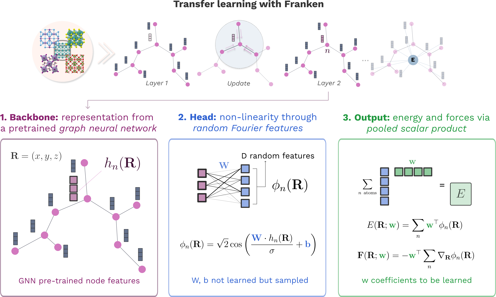

# Franken

[](https://github.com/CSML-IIT-UCL/franken/actions/workflows/CI.yaml)
[](https://franken.readthedocs.io/)


## Introduction

Franken is an open-source library that can be used to enhance the accuracy of atomistic foundation models. It can be used for molecular dynamics simulations, and has a focus on computational efficiency.

`franken` features include:
 - Supports fine-tuning for a variety of foundation models ([MACE](https://github.com/ACEsuit/mace), [UPET](https://github.com/lab-cosmo/upet/tree/main))
 - Automatic [hyperparameter tuning](https://franken.readthedocs.io/notebooks/autotune.html) simplifies the adaptation procedure, for an out-of-the-box user experience.
 - Several random-feature approximations to common kernels (e.g. Gaussian, polynomial) are available to flexibly fine-tune any foundation model.
 - Support for running within [LAMMPS](https://www.lammps.org/) molecular dynamics, as well as with [ASE](https://wiki.fysik.dtu.dk/ase/).



For detailed information and benchmarks please check our paper [*Fast and Fourier Features for Transfer Learning of Interatomic Potentials*](https://arxiv.org/abs/2505.05652).

## Documentation

A full documentation including several examples is available: [https://franken.readthedocs.io/index.html](https://franken.readthedocs.io/index.html). [The paper](https://arxiv.org/abs/2505.05652) also contains a comprehensive description of the methods behind franken.

## Install

Python 3.11 or newer is required. The default installation includes the MACE
backbone, so it can run the training example below:

```bash
pip install franken
```

For a uv project:

```bash
uv add franken
```

MACE runs on CPUs and CUDA GPUs through PyTorch. Install a platform-specific
PyTorch build first if you need a particular CUDA version; CuPy is optional.
The old `franken[mace]` extra remains a compatibility alias.

Optional dependencies include:

- `cueq-cu12` or `cueq-cu13` for cuEquivariance CUDA kernels matching your
  PyTorch CUDA version. Enable them with `--mace.use-cueq` during training.
- `pet` for UPET through Metatomic/Metatrain.
- `docs` and `develop` for documentation and development tools.

For example, with a CUDA 13 PyTorch build:

```bash
pip install "franken[cueq-cu13]"
```

See the [installation guide](https://franken.readthedocs.io/topics/intro_installation.html)
for GPU setup, optional CuPy acceleration, and cuEquivariance requirements.

## Quickstart

### Train
You can directly run `franken.autotune` to get started with the `franken` library.

```bash
franken.autotune \
    --train-path train.xyz \
    --val-path val.xyz \
    --backbone=mace --mace.path-or-id "mace_mp/small" --mace.interaction-block 2 \
    --rf=ms-gaussian --ms-gaussian.num-rf 4096 --ms-gaussian.length-scale-num 5\
    --ms-gaussian.length-scale-low 1  --ms-gaussian.length-scale-high 32 \
    --force-weight=0.99 \
    --l2-penalty="(-10, -6, 5, log)" \
    --metrics energy_MAE forces_MAE \
    --jac-chunk-size "auto"
```

For more details you can check out the [autotune tutorial](https://franken.readthedocs.io/notebooks/autotune.html) or the [getting started notebook](https://franken.readthedocs.io/notebooks/getting_started.html).

### Inference/MD
The trained model can be used as a ASE (Atomistic Simulations Environment) calculator for easy inference.

```python
from franken.calculators import FrankenCalculator
calc = FrankenCalculator('best_model.ckpt', device='cuda:0')
atoms.calc = calc
```

See the [MD tutorial](.https://franken.readthedocs.io/notebooks/molecular_dynamics.html) for a complete example about running molecular dynamics, while for deploying it to LAMMPS see the dedicated [page](https://franken.readthedocs.io/topics/lammps.html).

## Citing

If you find this library useful, please cite our work using the folowing bibtex entry:
```
@article{novelli2025fast,
  title={Fast and Fourier features for transfer learning of interatomic potentials},
  author={Novelli, Pietro and Meanti, Giacomo and Buigues, Pedro J and Rosasco, Lorenzo and Parrinello, Michele and Pontil, Massimiliano and Bonati, Luigi},
  journal={npj Computational Materials},
  volume={11},
  number={1},
  pages={293},
  year={2025},
  publisher={Nature Publishing Group UK London}
}
```
